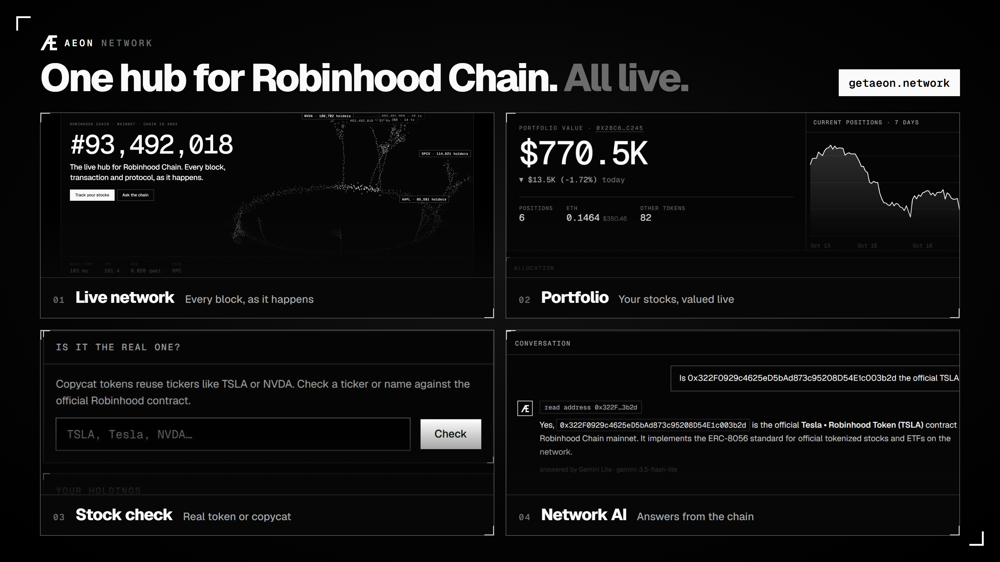

<p align="center"></p>

# Aeon Network — the live hub for Robinhood Chain

[**getaeon.network**](https://getaeon.network) · [X @getaeon_network](https://x.com/getaeon_network) · [Status](https://getaeon.network/#/status) · [Docs](https://getaeon.network/#/docs)

Every block, every tokenized stock and an AI that answers straight from the chain, for Robinhood Chain (Arbitrum Orbit L2, chain ID 4663). All data is real: read from the chain or from public data providers, and every number links to its source. Nothing is mocked; when a source is down the UI says so.

<p align="center"></p>

## Features

| | Feature | What it does |
|---|---|---|
| 01 | **Live network** | Block height, block time, TPS, gas and the dollar cost of a transfer, live block and transaction feeds, daily charts, most-called contracts. Pushed to the browser as blocks land. |
| 02 | **Portfolio** | Any wallet's tokenized stocks, valued like a brokerage app: total value, today's gain or loss, 7-day history, allocation and every transfer. Copycat and phishing tokens are flagged and never counted. Read-only, no wallet connection needed. |
| 03 | **Stocks & stock check** | All ~200 official ERC-8056 stock tokens with holders, market cap and volume, a market-cap map, and a checker that tells the official token from look-alikes. |
| 04 | **Network AI** | Reads blocks, transactions, wallets and tokens before it answers. Paste a hash or address and get it explained in plain language. Fails over across Gemini, Gemini Lite and OpenRouter. |
| 00 | **Network Pulse** | Robinhood Chain today in one report: activity, fees, DEX volume, value locked, stablecoins, stock tokens and whales, with day-over-day change. |
| 05 | **Whale tracker** | Large buys and sells of official stock tokens, read from the chain every 2 minutes via Alchemy. Swaps routed through pools are netted per wallet. Filter by size, stock and side; every whale links to its portfolio. |
| 06 | **Leaderboard** | The 50 largest tokenized-stock portfolios on Robinhood Chain (individual wallets only), refreshed every 30 minutes, each linking to its portfolio. |
| | **Explorer** | Search, blocks, decoded transactions, addresses and token profiles, cross-checked between RPC and Blockscout. |
| | **Wallet tools** | Wallet check (holdings, copycats, risky approvals with revoke), watchlist with alerts, add Robinhood Chain to your wallet. Wallet connection is always optional. |
| | **Aeon RPC** | A public, rate-limited JSON-RPC endpoint: `https://getaeon.network/rpc/mainnet` |

## Community token

The Aeon community token lives on Robinhood Chain and was launched on Pons.

```
CA: 0xb4fc414ac279bb3136e3cf7ec5084846af3bb459
```

The only official address is the one shown at the bottom of every page on [getaeon.network](https://getaeon.network) and posted by [@getaeon_network](https://x.com/getaeon_network). Nothing here is financial advice.

## Run

```bash
npm install
cp .env.example .env   # Windows: copy .env.example .env
npm start              # http://localhost:3000
```

Node.js 22+. Dev mode with auto-restart: `npm run dev`.

## Pages

| Route | What it shows | Source |
|---|---|---|
| `#/` Network | Live block height, block time, TPS, gas and transfer cost, live block & tx feeds, charts, most-called contracts | RPC + Aeon indexer, Blockscout |
| `#/stocks` | Official stock tokens, market-cap map, stock check | Blockscout |
| `#/portfolio` | Brokerage-style view of any wallet's stock tokens | Blockscout, CoinGecko |
| `#/explorer` | Search, blocks, transactions, addresses | RPC, Blockscout |
| `#/token/:addr` | Token profile: supply, holders, top holders, transfers, price history | Blockscout, CoinGecko |
| `#/ecosystem` | TVL, protocols, stablecoins, DEX volume, fees | DefiLlama |
| `#/check` · `#/wallet` | Wallet check and watchlist | Blockscout, RPC |
| `#/ai` | Network AI with chain tools | Gemini / OpenRouter / Claude + the above |
| `#/status` · `#/docs` · `#/faq` | Live upstream status, docs, FAQ | |

Mainnet/Testnet switch in the top bar applies to every page.

## API keys

| Key | Needed? | Why | Where |
|---|---|---|---|
| `ALCHEMY_API_KEY` | **Recommended** | Private RPC so the indexer avoids public-RPC rate limits | alchemy.com (free) |
| `BLOCKSCOUT_API_KEY` | Recommended | Network totals, history, token data (PRO API) | dev.blockscout.com (free) |
| `GEMINI_API_KEY` | For the AI | Gemini and Gemini Lite, separate free quotas | aistudio.google.com (free) |
| `OPENROUTER_API_KEY` | Optional | AI fallback | openrouter.ai (free models) |
| `ANTHROPIC_API_KEY` | Optional | Strongest AI provider | console.anthropic.com (paid) |
| `COINGECKO_API_KEY` | Optional | Stock-token prices, ETH/USD | coingecko.com (free Demo) |

DefiLlama needs no key. See [.env.example](.env.example) for every setting.

## How the backend stays inside free limits

- **One indexer for everyone** ([server/services/indexer.js](server/services/indexer.js)): follows each network's head, reads blocks with transactions plus all ERC-20 `Transfer` logs in **one batched JSON-RPC call per tick** (~0.4 req/s), and keeps rolling per-minute and per-hour stats. Visitors never trigger block reads.
- **Push, not polling**: new blocks, transactions and stats go to browsers over SSE (`/api/stream`).
- **Stale-while-revalidate cache with request coalescing** ([server/lib/cache.js](server/lib/cache.js)), persisted to `.cache/` so restarts don't re-spend quota. Blocks and token metadata are cached long-term (they don't change).
- **Circuit breakers**: an unreachable RPC or explorer is retried after a pause instead of on every request; the indexer jumps to the head if it falls too far behind and reports the gap honestly.
- **Per-IP rate limit on the AI.**

## Structure

```
server/
  config.js              networks, indexer, keys
  services/chain.js      RPC (failover, batching), blocks, txs, addresses, ERC-20 decoding
  services/indexer.js    live network indexer + rolling stats
  services/ecosystem.js  DefiLlama, Blockscout, ETH price, news
  services/ai.js         Network AI (Claude + chain tools, streamed)
  lib/                   cache, rate limits, SSE hub
public/
  css/style.css          black & white, ruled boxes, monochrome aurora
  js/views/*.js          network, explorer, ecosystem, tokens, wallet, ai
  js/charts.js           monochrome canvas charts with hover
```

## Test

```bash
npm test                                  # starts a throwaway server on :3999 and checks every endpoint
BASE=https://getaeon.network npm test     # checks a live deployment
```

## Deploy to getaeon.network

Production runs on an Ubuntu 24.04 VPS: Caddy (automatic HTTPS) in front of one Node process managed by systemd. Everything lives in [`deploy/`](deploy/).

1. DNS (Cloudflare): `A  getaeon.network → SERVER_IP` and `CNAME  www → getaeon.network`, both **DNS only** (grey cloud) so Caddy can issue the certificate.
2. From the project root on your machine:

```bash
deploy/deploy.sh root@SERVER_IP --setup --env   # first time: install Node, Caddy, firewall; upload .env; deploy
deploy/deploy.sh root@SERVER_IP                 # every later release (deploys the last commit)
BASE=https://getaeon.network npm test           # verify the live site
```

Each release is unpacked into its own folder and only switched live after it passes a health check; a failed release rolls back automatically. Run a single instance: the indexer and live stream keep state in memory. Logs: `journalctl -u aeon -f`. ([`ecosystem.config.cjs`](ecosystem.config.cjs) is an alternative for hosts that use PM2.)

> Not financial advice. Network figures come from Aeon's indexer and cover only the window it reports.
