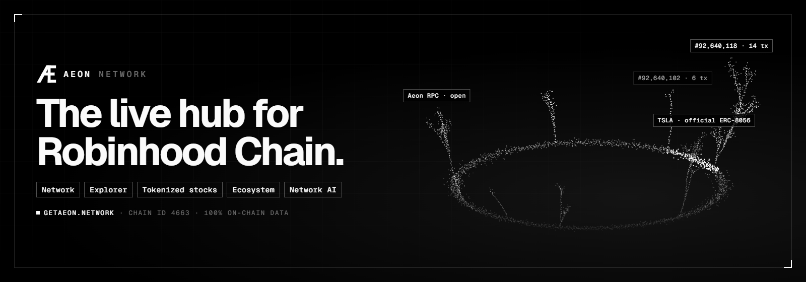

<p align="center"></p>

# Aeon Network — the live hub for Robinhood Chain

[getaeon.network](https://getaeon.network) · [X @getaeon_network](https://x.com/getaeon_network) · [Status](https://getaeon.network/#/status) · [Docs](https://getaeon.network/#/docs)

**getaeon.network** · Network activity, block explorer, ecosystem directory, tokens, wallet tools and a network AI for Robinhood Chain (Arbitrum Orbit L2, chain ID 4663). All data is real: read from the chain or from public data providers. Nothing is mocked; when a source is down the UI says so.

## Run

```bash
npm install
cp .env.example .env   # Windows: copy .env.example .env
npm start              # http://localhost:3000
```

Node.js 22+. Dev mode with auto-restart: `npm run dev`.

## Pages (all routes live under the network)

| Route | What it shows | Source |
|---|---|---|
| `#/` Network | Live block height, block time, TPS, gas (+ $ cost of a transfer), tx/active addresses/deployments/token transfers, per-minute charts, live block & tx feeds, most active contracts | RPC + Aeon indexer |
| `#/explorer` | Search; latest blocks, txs, contract deployments; `/block/:n`, `/tx/:hash` (decoded token transfers, fee), `/address/:addr` (balance, token balances, history) | RPC, Blockscout |
| `#/ecosystem` | TVL + rank, protocols, stablecoins, DEX volume, fees, charts, protocol directory, Robinhood news | DefiLlama, Cointelegraph |
| `#/tokens` | ERC-20 tokens ranked by transfers, discovered automatically | Aeon indexer + RPC |
| `#/wallet` | Connect wallet, ETH & token balances, send ETH, add network, testnet faucet | Wallet (EIP-6963), RPC |
| `#/ai` | Network AI that looks up blocks, txs, addresses and ecosystem data with tools | Claude + all of the above |

Mainnet/Testnet switch in the top bar applies to every page.

## API keys

| Key | Needed? | Why | Where |
|---|---|---|---|
| `ALCHEMY_API_KEY` | **Recommended** | The indexer reads every block; a private RPC avoids public-RPC rate limits | alchemy.com (free) → app on Robinhood Chain |
| `ANTHROPIC_API_KEY` | Required for AI | Network AI | console.anthropic.com (paid per use) |
| `BLOCKSCOUT_API_KEY` | Optional | Higher limits for address history | Blockscout → My account → API keys (free) |
| `COINGECKO_API_KEY` | Optional | ETH/USD rate | coingecko.com/en/api/pricing → Demo (free) |

DefiLlama and Cointelegraph need no key.

## How the backend stays inside free limits

- **One indexer for everyone** ([server/services/indexer.js](server/services/indexer.js)): follows each network's head, reads blocks with transactions plus all ERC-20 `Transfer` logs in **one batched JSON-RPC call per tick** (~0.4 req/s), and keeps rolling per-minute and per-hour stats. Visitors never trigger block reads.
- **Push, not polling**: new blocks, transactions and stats go to browsers over SSE (`/api/stream`).
- **Stale-while-revalidate cache with request coalescing** ([server/lib/cache.js](server/lib/cache.js)), persisted to `.cache/` so restarts don't re-spend quota. Blocks and token metadata are cached long-term (they don't change).
- **Circuit breakers**: an unreachable RPC or explorer is retried after a pause instead of on every request; the indexer jumps to the head if it falls too far behind and reports the gap honestly.
- **Per-IP rate limit on the AI.**

## Structure

```
server/
  config.js              networks, indexer, keys
  services/chain.js      RPC (failover, batching), blocks, txs, addresses, ERC-20 decoding
  services/indexer.js    live network indexer + rolling stats
  services/ecosystem.js  DefiLlama, Blockscout, ETH price, news
  services/ai.js         Network AI (Claude + chain tools, streamed)
  lib/                   cache, rate limits, SSE hub
public/
  css/style.css          black & white, ruled boxes, monochrome aurora
  js/views/*.js          network, explorer, ecosystem, tokens, wallet, ai
  js/charts.js           monochrome canvas charts with hover
```

## Test

```bash
npm test                                  # starts a throwaway server on :3999 and checks every endpoint
BASE=https://getaeon.network npm test     # checks a live deployment
```

## Deploy to getaeon.network

Production runs on an Ubuntu 24.04 VPS: Caddy (automatic HTTPS) in front of one Node process managed by systemd. Everything lives in [`deploy/`](deploy/).

1. DNS (Cloudflare): `A  getaeon.network → SERVER_IP` and `CNAME  www → getaeon.network`, both **DNS only** (grey cloud) so Caddy can issue the certificate.
2. From the project root on your machine:

```bash
deploy/deploy.sh root@SERVER_IP --setup --env   # first time: install Node, Caddy, firewall; upload .env; deploy
deploy/deploy.sh root@SERVER_IP                 # every later release (deploys the last commit)
BASE=https://getaeon.network npm test           # verify the live site
```

Each release is unpacked into its own folder and only switched live after it passes a health check; a failed release rolls back automatically. Run a single instance: the indexer and live stream keep state in memory. Logs: `journalctl -u aeon -f`. ([`ecosystem.config.cjs`](ecosystem.config.cjs) is an alternative for hosts that use PM2.)

> Not financial advice. Network figures come from Aeon's indexer and cover only the window it reports.
